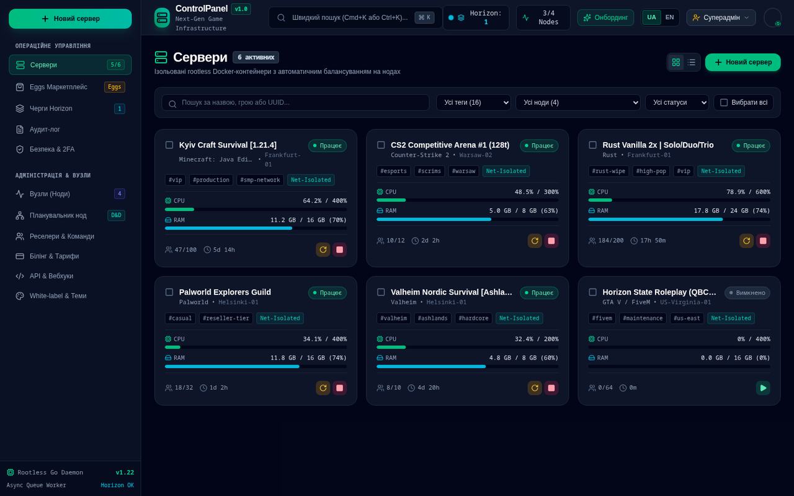

# ControlPanel

A modern game-server management dashboard concept. It demonstrates a control-plane UI for servers, nodes, placement, marketplace eggs, queues, audit logs, billing, security settings and multi-tenant views.

The current repository is a frontend-focused prototype. It uses mock data and does not include a production backend.



## Features

- Server list and server detail views.
- Node management and resource monitoring.
- Placement scheduler.
- Egg marketplace.
- Background job queues.
- Audit logs.
- Billing and white-label views.
- Security settings.
- Multi-tenant view.
- API and webhook management.

## Tech stack

- React 19
- TypeScript
- Vite
- Tailwind CSS
- Lucide React
- Motion

## Quick start

```bash
npm install
npm run dev
```

Open `http://localhost:3000`.

## Development notes

- The project uses mock data in `src/mockData.ts`.
- Tokens and identifiers in the mock data are synthetic demo values only.
- `npm run lint` runs TypeScript checks.

## Project structure

```text
ControlPanel/
├── src/
│   ├── components/
│   ├── context/
│   ├── mockData.ts
│   └── types.ts
├── index.html
├── package.json
└── vite.config.ts
```

## License

This project is licensed under the [MIT License](LICENSE).

## Українською (коротко)

ControlPanel — концепт сучасної панелі керування ігровими серверами. Це frontend-прототип із мок-даними: сервери, ноди, планувальник, маркетплейс, черги, аудит, білінг, безпека та мультитенантність. Запуск: `npm install && npm run dev`.